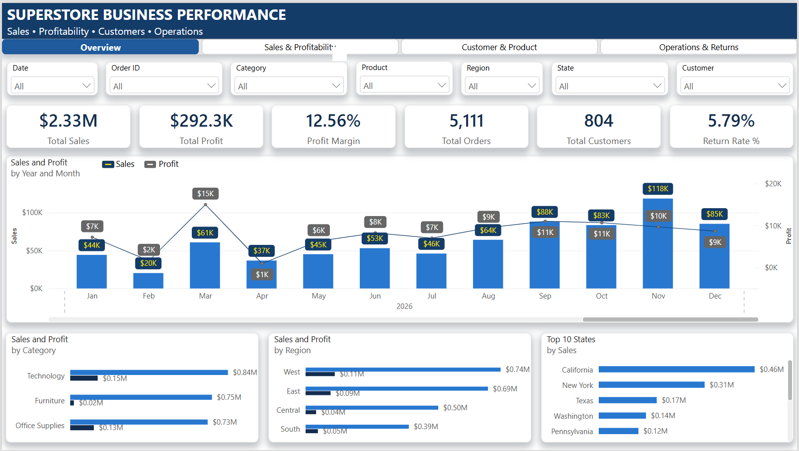
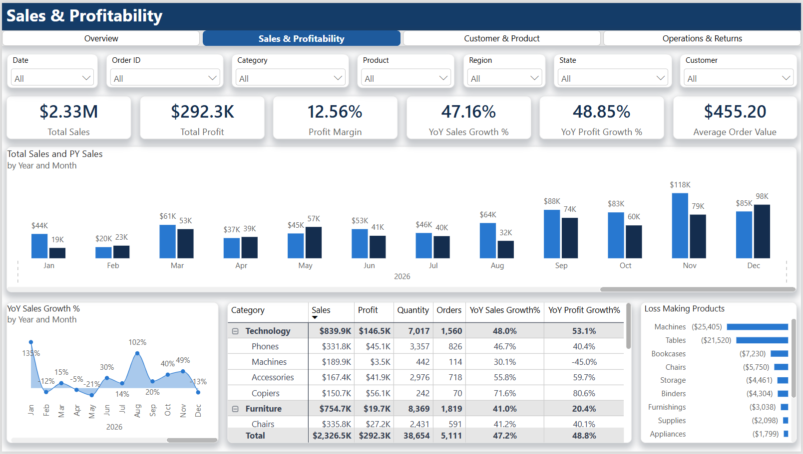
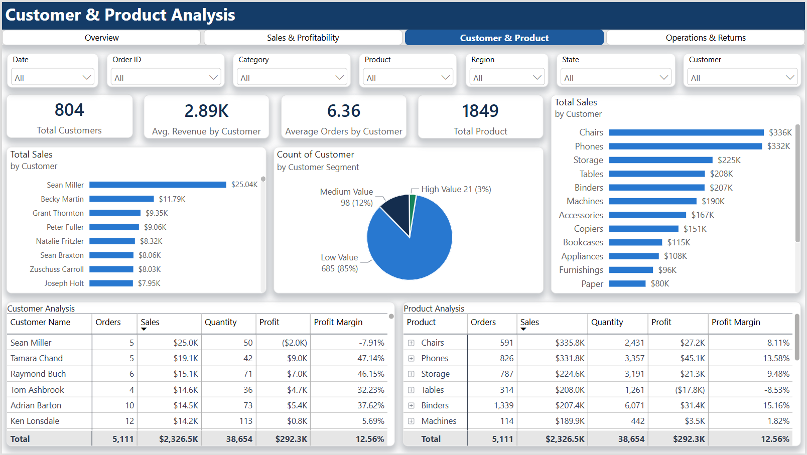
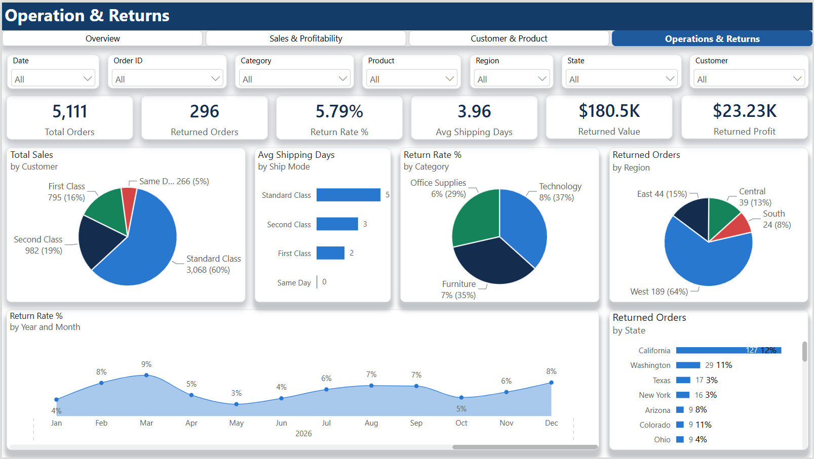

# 📊 Sales Performance & Business Analytics Dashboard

An interactive **Power BI business intelligence solution** designed to analyze sales performance, profitability, customer behavior, product performance, shipping operations, and returns.

The project demonstrates an end-to-end Power BI development approach including **data modeling, Power Query, DAX, time intelligence, interactive navigation, drill-through analysis, dynamic metrics, and business-focused dashboard design**.

---

## 🎯 Business Objective

The objective of this dashboard is to provide business stakeholders with a centralized view of sales and operational performance and help identify:

- Overall sales and profit performance
- Sales and profit trends over time
- Year-over-year business growth
- High and low performing categories and products
- Customer contribution and performance
- Regional performance
- Loss-making products
- Shipping performance
- Returned orders and return rates
- Key business performance indicators

---

## 🛠️ Technologies & Skills

- **Power BI Desktop**
- **DAX**
- **Power Query**
- **Data Modeling**
- **Star Schema**
- **Time Intelligence**
- **Interactive Visualizations**
- **Field Parameters**
- **Drill-through**
- **Report Page Tooltips**
- **Bookmarks**
- **Page Navigation**
- **Dynamic Slicers**
- **Conditional Formatting**
- **KPI Design**
- **Business Intelligence & Data Analytics**

---

## 📐 Data Model

The solution uses a structured Power BI semantic model consisting of:

- **Orders** – Transaction-level sales data
- **Returns** – Returned order information
- **People** – Regional manager information
- **DimDate** – Dedicated calendar/date dimension

The model is designed to support scalable reporting, time-intelligence calculations, and interactive filtering.

### Main analytical dimensions

- Date
- Region
- State
- City
- Segment
- Category
- Sub-Category
- Product
- Customer
- Ship Mode

---

## 📊 Dashboard Pages

### 1. Executive Overview

Provides a high-level business summary including:

- Total Sales
- Total Profit
- Profit Margin
- Total Orders
- Total Customers
- Return Rate
- Sales & Profit trends
- Category performance
- Regional performance
- Top-performing locations



---

### 2. Sales & Profitability

Provides detailed analysis of sales and profitability across different business dimensions.

Key analysis includes:

- Monthly sales trends
- Profit trends
- Year-over-year growth
- Category performance
- Sub-category performance
- Profit margins
- Loss-making products
- Sales vs previous year comparison



---

### 3. Customer & Product Analytics

Provides detailed customer and product performance analysis.

Key analysis includes:

- Top customers
- Customer contribution
- Customer segmentation
- Top products
- Product profitability
- Sales by product
- Quantity and order analysis
- Product-level performance comparison



---

### 4. Operations & Returns

Analyzes operational performance and returned orders.

Key analysis includes:

- Orders by shipping mode
- Average shipping duration
- Return rate
- Returned orders
- Return analysis by category
- Return analysis by region
- Operational performance indicators



---

## 🧮 Key DAX Measures

The dashboard includes business and time-intelligence measures such as:

```text
Total Sales
Total Profit
Total Quantity
Total Orders
Total Customers
Profit Margin
Average Order Value
Previous Year Sales
Previous Year Profit
YoY Sales Growth %
YoY Profit Growth %
YTD Sales
YTD Profit
Returned Orders
Return Rate %
Average Shipping Days
```

### Example – Profit Margin

```DAX
Profit Margin =
DIVIDE(
    [Total Profit],
    [Total Sales],
    0
)
```

### Example – YoY Sales Growth

```DAX
YoY Sales Growth % =
DIVIDE(
    [Total Sales] - [PY Sales],
    [PY Sales],
    0
)
```

## 🎨 Interactive Features

The dashboard includes:

- Cross-filtering
- Interactive slicers
- Synchronized filters
- Page navigation
- Dynamic metric selection
- Drill-through analysis
- Report page tooltips
- Bookmarks
- Reset filter functionality
- Conditional formatting
- KPI cards
- Hierarchical matrix analysis

## 💡 Business Insights

The dashboard enables stakeholders to answer questions such as:

1. Which categories generate the highest revenue?
2. Which categories generate the highest profit?
3. Which products are loss-making?
4. Which regions contribute the most revenue?
5. Which customers generate the highest sales?
6. How is sales performance changing year over year?
7. What is the overall profit margin?
8. Which shipping modes have the longest delivery duration?
9. Which categories have the highest return rates?
10. Which products require further business attention?

---

## 📁 Project Structure

sales-performance-dashboard/
│
├── Superstore-PowerBI-Analytics/
│   ├── Business Performance Analysis.pbix
│   ├── 01_Executive_Overview.png
│   ├── 02_Sales_Profitability.png
│   ├── 03_Customer_Product.png
│   └── 04_Operations_Returns.png
│
└── README.md
```

---

## 🚀 Skills Demonstrated

This project demonstrates practical experience in:

**Data Preparation → Data Modeling → DAX → Visualization → Business Analysis → Interactive Reporting**

The solution focuses on building a maintainable and business-oriented Power BI report rather than simply creating individual charts.

---

## 👨‍💻 Project

**Power BI Business Analytics Portfolio Project**

Developed using Power BI Desktop with a focus on enterprise-style dashboard design, analytical modeling, DAX development, and interactive business reporting.
